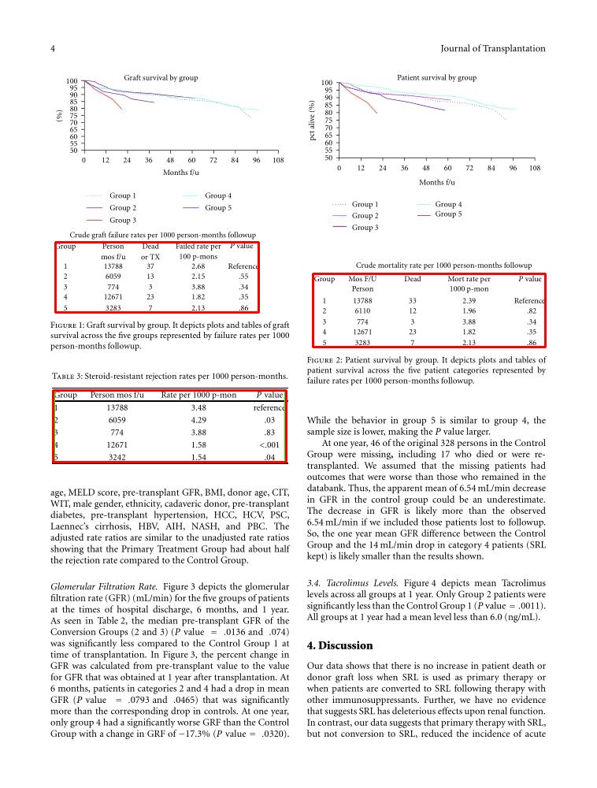
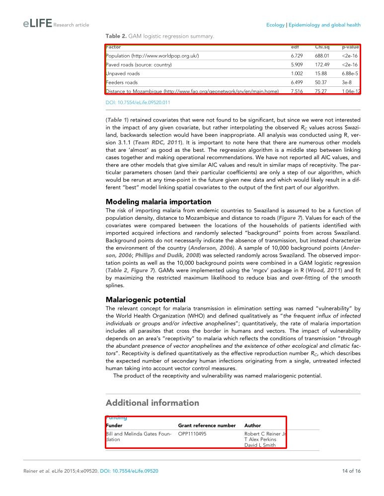
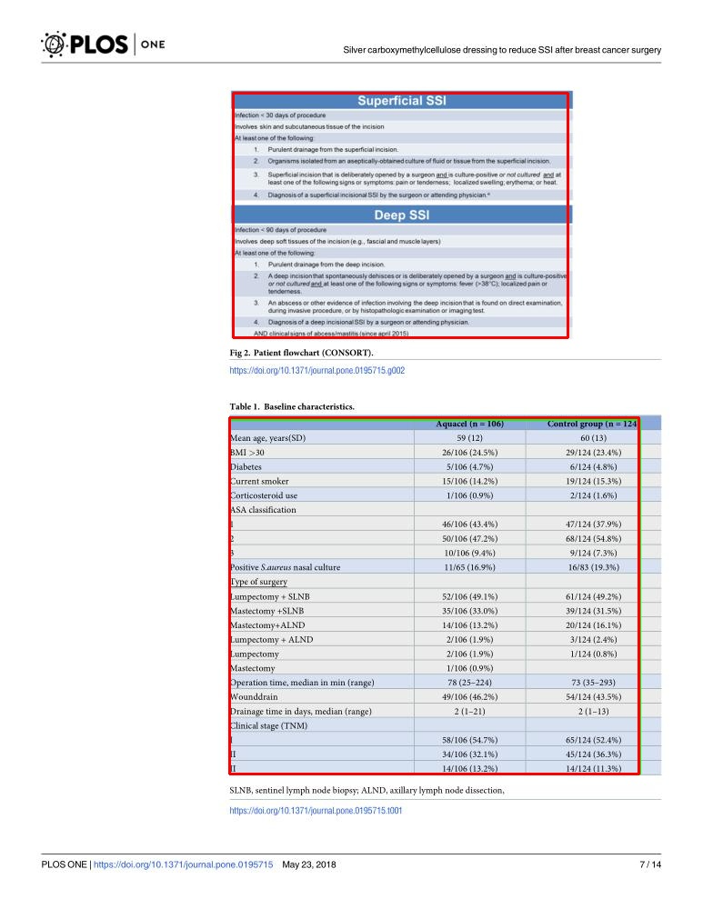
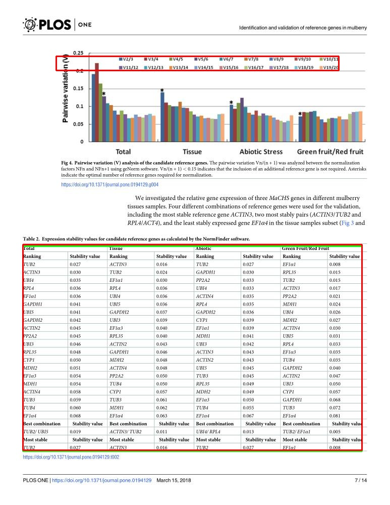

# Kết quả so sánh Yolo26n và Faster R-CNN

## Môi trường huấn luyện và kiểm thử

| Tiêu chí                 | Giá trị                                                             |
| ---------------------------- | ----------------------------------------------------------------------- |
| Bộ dữ liệu              | Subset 5% của PubTables-1M (`bsmock/pubtables-1m`) chia trên seed = 42                              |
| Số ảnh train / test      | 23029 / 2856                                                          |
| Lớp đối tượng         | 2 lớp:`table`,`table rotated` |
| Kích thước ảnh (imgsz) | 640                                                                   |
| Số epoch                  | 10                                                                    |
| Thiết bị                 | NVIDIA L4 (22563 MiB)                                                 |
| Seed                       | 42                                                                    |

## Kết quả

| Tiêu chí                 | **YOLO26n**                   | **Faster R-CNN** |
| ---------------------------- | ------------------------------------- | ------------------------ |
| Thiết bị                 | NVIDIA L4                           | NVIDIA L4              |
| Kích thước ảnh (imgsz) | 640                                 | 640                    |
| mAP@0.5                    | **0.9950**                    | 0.9876                 |
| mAP@0.5:0.95               | **0.9838**                    | 0.8943                 |
| Độ trễ / ảnh           | **\~3.5 ms**(0.9 + 1.9 + 0.7) | 27.7 ms      |
| FPS                        | **\~285**                     | 36.0          |

## Kết luận

Qua kết quả thử nghiệm sơ bộ mô hình Yolov26n đặt độ chính xác cũng như hiệu năng vượt trội so với Faster R-CNN. Đặc biệt ở hiệu năng khi Yolov26n nhanh hơn 8 lần so với Faster R-CNN.

Các lỗi chủ yếu mà mô hình YOLO mắc phải:

- Mô hình nhận diện bảng nằm trong Figure: đây là lỗi do mô hình huấn luyện đơn thuần để nhận diện bảng, không gây ảnh hưởng tới bài toán hiện tại.
  
- Nhầm lẫn bảng dữ liệu và các thông tin có định dạng giống bảng:
  
  
- Sai hoàn toàn
  

# Kết quả so sánh Yolo26n và Baseline TATR

Setup model Yolo26n như trên, chỉ khác model được train trên toàn tập Pubtables-1M và chạy trên A100

| Tiêu chí                 | **YOLO26n**                   | **TATR (DETR)** |
| ---------------------------- | ------------------------------------- | ------------------------ |
| Thiết bị                 | NVIDIA A100-SXM4-40GB                           | NVIDIA A100-SXM4-40GB              |
| mAP@0.5                    | 0.9950                    | 0.9950                 |
| mAP@0.5:0.95               | **0.9850**                    | 0.9694                 |
| Precision               | **0.9995**                    | 0.9984                 |
| Recall               | **0.9992**                    | 0.9987                 |
| Độ trễ / ảnh           | **\~1.2 ms**(0.4 + 0.0 + 0.8) |    35.8ms  |
| Lượng tham số | 2.39M | 28.8M |

Kết quả thực nghiệm cho thấy mô hình Yolo26n đạt độ chính xác tương đương hoặc hơn so với TATR với hiệu năng chênh lệch rõ rệt ~30x

The 

